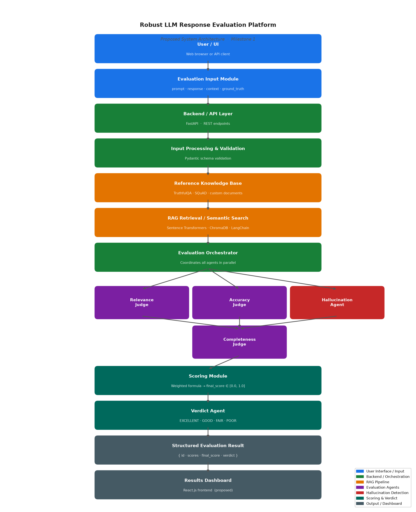

# System Architecture

**Project:** Robust LLM Response Evaluation Platform  
**Milestone:** M1 — Proposed System Architecture  
**Date:** August 2025

> This document describes the **proposed Milestone 1 system architecture**. The architecture defines the intended design and data flow. Full implementation will progress through subsequent milestones.

---

## Architecture Diagram



---

## Proposed Architecture

```
┌─────────────────────────────────────────┐
│              USER / UI                  │
│     Web browser or API client           │
└──────────────────┬──────────────────────┘
                   │
                   ▼
┌─────────────────────────────────────────┐
│        EVALUATION INPUT MODULE          │
│  prompt · response · context (optional) │
│  ground_truth (optional)                │
└──────────────────┬──────────────────────┘
                   │
                   ▼
┌─────────────────────────────────────────┐
│         BACKEND / API LAYER             │
│         FastAPI  ·  REST endpoints      │
└──────────────────┬──────────────────────┘
                   │
                   ▼
┌─────────────────────────────────────────┐
│    INPUT PROCESSING & VALIDATION        │
│    Pydantic schema validation           │
└──────────────────┬──────────────────────┘
                   │
                   ▼
┌─────────────────────────────────────────┐
│      REFERENCE KNOWLEDGE BASE           │
│  TruthfulQA · SQuAD · custom documents  │
└──────────────────┬──────────────────────┘
                   │
                   ▼
┌─────────────────────────────────────────┐
│    RAG RETRIEVAL / SEMANTIC SEARCH      │
│  Sentence Transformers · ChromaDB       │
│  LangChain retrieval pipeline           │
└──────────────────┬──────────────────────┘
                   │
                   ▼
┌─────────────────────────────────────────┐
│        EVALUATION ORCHESTRATOR          │
│  Coordinates all agents in parallel     │
└────┬──────────┬──────────┬──────────────┘
     │          │          │
     ▼          ▼          ▼
┌─────────┐ ┌─────────┐ ┌──────────────┐
│RELEVANCE│ │ACCURACY │ │HALLUCINATION │
│  JUDGE  │ │  JUDGE  │ │    AGENT     │
└─────────┘ └─────────┘ └──────────────┘
     │          │          │
     └──────────┴──────────┘
                │
                ▼
     ┌──────────────────┐
     │  COMPLETENESS    │
     │     JUDGE        │
     └────────┬─────────┘
              │
              ▼
┌─────────────────────────────────────────┐
│           SCORING MODULE                │
│  Weighted formula → final_score [0,1]   │
└──────────────────┬──────────────────────┘
                   │
                   ▼
┌─────────────────────────────────────────┐
│            VERDICT AGENT                │
│  EXCELLENT · GOOD · FAIR · POOR         │
└──────────────────┬──────────────────────┘
                   │
                   ▼
┌─────────────────────────────────────────┐
│     STRUCTURED EVALUATION RESULT        │
│  { id · scores · final_score · verdict }│
└──────────────────┬──────────────────────┘
                   │
                   ▼
┌─────────────────────────────────────────┐
│         RESULTS / DASHBOARD             │
│         React.js frontend               │
└─────────────────────────────────────────┘
```

---

## Component Descriptions

### User / UI
The interface through which users submit LLM responses for evaluation and view results. Proposed as a React.js web application. Users provide the original prompt, the LLM response to evaluate, and optionally a reference context or ground truth answer.

### Evaluation Input Module
Accepts the evaluation payload and passes it to the backend. The minimum required input is a prompt and a response. Optional fields include a reference context (for grounded evaluation) and a ground truth answer (for accuracy benchmarking).

### Backend / API Layer
A FastAPI application that exposes REST endpoints for submitting evaluation requests and retrieving results. FastAPI is chosen for its async-first design, automatic OpenAPI documentation, and native Pydantic integration.

### Input Processing & Validation
Pydantic models validate and parse the incoming request, ensuring required fields are present and correctly typed. Invalid requests are rejected with descriptive error messages before any processing occurs.

### Reference Knowledge Base
A collection of documents stored as vector embeddings in ChromaDB. The knowledge base is populated from TruthfulQA, SQuAD v2, and optionally custom documents. It provides factual grounding for the evaluation agents.

### RAG Retrieval / Semantic Search
Given the evaluation prompt, this component retrieves the most semantically relevant document chunks from the knowledge base using cosine similarity over sentence-transformer embeddings. The retrieved chunks are passed as context to the evaluation agents. The pipeline is built with LangChain.

### Evaluation Orchestrator
Coordinates all four evaluation agents, running them in parallel for efficiency. Collects the scores returned by each agent and passes them to the Scoring Module.

### Relevance Judge
An LLM-as-a-Judge agent that scores how well the response addresses the question. Produces a score from 0.0 (completely irrelevant) to 1.0 (perfectly relevant). Weight in final score: 25%.

### Accuracy Judge
An LLM-as-a-Judge agent that scores the factual correctness of the response against the retrieved reference context or ground truth answer. Produces a score from 0.0 (factually wrong) to 1.0 (fully accurate). Weight in final score: 30%.

### Hallucination Agent
An LLM-as-a-Judge agent that detects unsupported or fabricated claims in the response. Produces a hallucination score from 0.0 (no hallucination) to 1.0 (fully hallucinated). This score is inverted in the final formula so that lower hallucination improves the result. Weight in final score: 25%.

### Completeness Judge
An LLM-as-a-Judge agent that scores how thoroughly the response covers all aspects of the question. Produces a score from 0.0 (incomplete) to 1.0 (fully complete). Weight in final score: 20%.

### Scoring Module
Applies the weighted formula to the four agent scores to produce a single `final_score` between 0.0 and 1.0:

```
Final Score = 0.25 × Relevance
            + 0.30 × Accuracy
            + 0.25 × (1 − Hallucination)
            + 0.20 × Completeness
```

### Verdict Agent
Maps the final score to a human-readable verdict label: EXCELLENT (≥0.85), GOOD (≥0.70), FAIR (≥0.50), or POOR (<0.50).

### Structured Evaluation Result
A JSON object containing the evaluation ID, per-agent scores, final score, and verdict label. Persisted to a SQLite database and returned to the client.

### Results / Dashboard
A React.js frontend that displays evaluation results, per-agent score breakdowns, and historical evaluation trends. Proposed for a later milestone.

---

## Data Flow Summary

1. User submits `{ prompt, response, context?, ground_truth? }` via the UI or API
2. FastAPI validates the request via Pydantic
3. RAG pipeline retrieves relevant reference chunks from the knowledge base
4. Orchestrator runs all four agents in parallel
5. Each agent calls the LLM with a scoring prompt and returns a 0.0–1.0 score
6. Scoring Module computes the weighted final score
7. Verdict Agent assigns a verdict label
8. Result is persisted to SQLite and returned as structured JSON
9. Dashboard displays the result to the user
